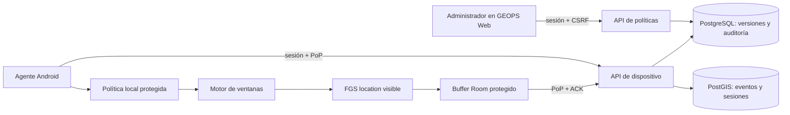

# Arquitectura propuesta — políticas remotas y agente

## P0 de subida: sesión y primeras posiciones en un COMMIT

[GPS-UPLOAD-STARTED-BLOCKER](gps-upload-started-blocker-p0-2026-10-21.md) introduce una propuesta de ingesta v2 previa a las waves A–E. La cola cifrada y el motor de captura avanzan sin esperar red ni ACK. El uploader selecciona registros por `client_session_id`, incluye el `STARTED` original junto a los primeros puntos cuando la sesión aún no existe y permite que otras sesiones progresen aunque una falle. El backend autentica dispositivo/instalación y tenant, valida política y horario por evento, reconcilia la sesión canónica e inserta puntos, recibo y auditoría en una sola transacción. Solo el ACK exacto posterior al COMMIT libera IDs locales. Los lotes de sesiones distintas son transacciones separadas; un error de una no establece una barrera global. La subida v2 requiere diseño y pruebas; el flujo v1 descrito abajo continúa siendo el implementado.

**Enmienda vigente 2026-10-21:** [ADR-020](../architecture/adr/ADR-020-ultima-politica-valida-offline.md) establece APK-FIRST/OFFLINE-FIRST/MDM-INDEPENDENT y sustituye las frases siguientes que exigen descarga para una nueva jornada, TTL de 12 h o red después de reboot. Los párrafos previos siguen describiendo el contrato HTTP/código v1 hasta su actualización; no acreditan implementación del nuevo contrato.

## Decisión y fronteras

GEOPS Web es la única superficie de configuración. Web usa sesión admin, Origin/CSRF de SPEC-01 y capacidades por administrador de [ADR-015](../architecture/adr/ADR-015-capacidades-administrativas-gps.md). La API valida y publica revisiones inmutables; PostgreSQL es fuente autoritativa. Android no edita ni propone su política. El dispositivo consulta su snapshot efectivo con identidad GEOPS, sesión corta y firma PoP de [SPEC-00](../spec-00-technical-feasibility/api-contracts.md). Las credenciales MDM nunca llegan al agente. La PoC permanece aislada; el producto usa migraciones y contratos propios.

## Publicación y resolución

Editar crea borrador; publicar valida esquema, ventana, zona IANA, superposiciones, vigencia, límites y autorización. No hay prioridad implícita entre política individual y grupal: se materializa una asignación efectiva por dispositivo/intervalo, rechazando solapes incluso cuando cambia un grupo. Una transacción bloquea dispositivos afectados, inserta revisión inmutable y asignaciones, aumenta `assignment_version` y escribe `audit_event`. El snapshot **v1 actual** entrega solo la política actual y próximas instancias UTC por siete días; Wave A debe versionarlo para que la asignación ya validada cubra nuevas jornadas offline con alcance demostrable. Una pausa/revocación publica tombstone versionado; no borra historia. Cambios llegan al próximo contacto y no se promete revocación instantánea offline. [ADR-020](../architecture/adr/ADR-020-ultima-politica-valida-offline.md) fija la decisión vigente; ADR-017 conserva historia de v1.

## Máquina del agente

`UNPROVISIONED → IDLE_NO_POLICY → READY → START_PENDING → CAPTURING → STOPPING → READY`; estados de fallo `BLOCKED_POLICY`, `BLOCKED_PERMISSION`, `BLOCKED_OS`, `BLOCKED_GPS` y `EXPIRED`. Al iniciar: comprobar identidad/clave, política persistida vigente, ventana UTC calculada con reglas IANA/versión compatibles, tiempo local evaluable, permisos y ubicación; promover FGS `location` con notificación visible cuando Android lo permita; tras confirmar registro del proveedor persistir `STARTED` con `client_session_id` provisional. El backend crea `session_id` canónico al aceptar ese evento [ADR-016](../architecture/adr/ADR-016-identidad-sesiones-gps.md). Al fin: cancelar solicitudes, poner barrera serial en callback/cola, registrar `STOPPED` con razón, detener FGS. Cada callback comprueba tiempo de captura y recepción contra ventana, versión y estado antes de escribir. No se insertan nuevas posiciones fuera de ventana; una ya persistida dentro puede sincronizarse después. El cálculo local y la ingesta de futuros boots son diseño pendiente, no comportamiento actual.

No hay promesa de despertar e iniciar un FGS desde fondo: una alarma/Worker puede reevaluar y notificar al usuario, pero si Android no permite inicio se registra intento fallido y se necesita interacción visible. El servicio ya activo se detiene al fin y ante revocación **recibida**, permiso/GPS perdido, reloj dudoso o `valid_until` vencido. Reinicio restaura la última política íntegra; el tiempo entre boots y la ruta Android legal se validan antes de capturar, sin inventar `STARTED` previo. Android 12/14/15 se prueban físicamente según [research](research.md). Mientras el FGS está activo, un temporizador del proceso usa el intervalo de sincronización como objetivo y la inserción de puntos puede adelantar un envío; fuera de ventana WorkManager reintenta pendientes con red/backoff. Ninguno garantiza ejecución al segundo. WorkManager no es reloj de captura.

## Identidad, replay y privacidad

La respuesta de política viaja sobre TLS y autenticación/PoP de SPEC-00, asociada a `geops_device_id` y `key_id`. El agente rechaza `assignment_version` menor que máximo durable, cuerpo ajeno, vigencia inválida y esquema desconocido. La política/versión se guardan protegidas; copia restaurada, pérdida Keystore o downgrade incierto bloquean captura. Reboot offline **ya no invalida automáticamente** la política, pero requiere resolver tiempo local y autorización histórica por contrato versionado. El servidor valida identidad y nonce en cada escritura; no acepta autoasignación. Privacidad/seguridad deben aceptar un riesgo de revocación diferida potencialmente de varios días antes de uso real. No se prometen garantías frente a teléfono comprometido; eventos dudosos quedan en cuarentena sin “corregir” su hora como hecho.

## Experiencia administrativa

Ruta operativa “Dispositivos → Políticas GPS”: lista con estado, versión, asignación y vigencia; editor de días/horas/zona/frecuencias con vista previa UTC y conflictos; revisión de dispositivos afectados y motivo; publicar/pausar/revocar con confirmación y auditoría. Ficha de dispositivo: versión publicada, descargada y reportada aplicada, ventana próxima, sesión programada/efectiva, interrupciones y backlog/último ACK. Un estado sin heartbeat se muestra “desconocido”. Resumen ejecutivo presenta cobertura agregada y salud, sin controles operativos ni coordenadas por defecto. Las capacidades de ADR-015 se imponen en API y solo se reflejan en UI; lectura de ubicaciones exige permiso y motivo auditado. No se exponen secretos ni IDs MDM completos.
