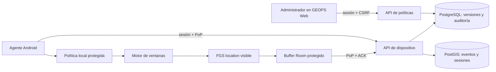

# Arquitectura propuesta — políticas remotas y agente

## Decisión y fronteras

GEOPS Web es la única superficie de configuración. Web usa sesión admin, Origin/CSRF de SPEC-01 y capacidades por administrador de [ADR-015](../architecture/adr/ADR-015-capacidades-administrativas-gps.md). La API valida y publica revisiones inmutables; PostgreSQL es fuente autoritativa. Android no edita ni propone su política. El dispositivo consulta su snapshot efectivo con identidad GEOPS, sesión corta y firma PoP de [SPEC-00](../spec-00-technical-feasibility/api-contracts.md). Las credenciales MDM nunca llegan al agente. La PoC permanece aislada; el producto usa migraciones y contratos propios.

## Publicación y resolución

Editar crea borrador; publicar valida esquema, ventana, zona IANA, superposiciones, vigencia, límites y autorización. No hay prioridad implícita entre política individual y grupal: se materializa una asignación efectiva por dispositivo/intervalo, rechazando solapes incluso cuando cambia un grupo. Una transacción bloquea dispositivos afectados, inserta revisión inmutable y asignaciones, aumenta `assignment_version` y escribe `audit_event`. El snapshot entrega solo la política actual y próximas instancias UTC dentro de su horizonte, sin revelar otros miembros; una asignación futura exige otra descarga online al iniciar. Una pausa/revocación publica tombstone versionado; no borra historia. Cambios urgentes llegan al próximo contacto y expiran en caché local protegida; no se promete revocación instantánea offline. [ADR-017](../architecture/adr/ADR-017-politicas-gps-temporales-offline.md) fija tiempo y resolución.

## Máquina del agente

`UNPROVISIONED → IDLE_NO_POLICY → READY → START_PENDING → CAPTURING → STOPPING → READY`; estados de fallo `BLOCKED_POLICY`, `BLOCKED_PERMISSION`, `BLOCKED_OS`, `BLOCKED_GPS` y `EXPIRED`. Al iniciar: comprobar identidad/clave, snapshot vigente, instancia UTC entregada por servidor, ancla de reloj, permisos y ubicación; promover FGS `location` con notificación visible; tras confirmar registro del proveedor persistir `STARTED` con `client_session_id` provisional. El backend crea `session_id` canónico al aceptar ese evento [ADR-016](../architecture/adr/ADR-016-identidad-sesiones-gps.md). Al fin: cancelar solicitudes, poner barrera serial en callback/cola, registrar `STOPPED` con razón, detener FGS. Cada callback comprueba tiempo de captura y de recepción local contra instancia UTC, versión y estado antes de escribir. No se insertan nuevas posiciones fuera de ventana; una ya persistida dentro puede sincronizarse después.

No hay promesa de despertar e iniciar un FGS desde fondo: una alarma/Worker puede reevaluar y notificar al usuario, pero si Android no permite inicio se registra intento fallido y se necesita interacción visible. El servicio ya activo se detiene al fin y ante revocación recibida, permiso/GPS perdido, reloj dudoso o expiración. Reinicio restaura política solo si su validez verificable sobrevive; nunca inventa `STARTED` previo. Android 12/14/15 se prueban físicamente según [research](research.md). Mientras el FGS está activo, un temporizador del proceso usa el intervalo de sincronización como objetivo y la inserción de puntos puede adelantar un envío; fuera de ventana WorkManager reintenta pendientes con red/backoff. Ninguno garantiza ejecución al segundo. WorkManager no es reloj de captura.

## Identidad, replay y privacidad

La respuesta de política viaja sobre TLS y autenticación/PoP de SPEC-00, asociada a `geops_device_id` y `key_id`. El agente rechaza `assignment_version` menor que máximo durable, cuerpo ajeno, vigencia inválida y esquema desconocido. Snapshot/ancla/versión se guardan protegidos; copia restaurada, pérdida Keystore, reboot offline o downgrade incierto bloquea captura hasta revalidar. El servidor valida identidad y nonce en cada escritura; no acepta autoasignación. Autorización offline máxima de 12 h y solo dentro de instancia vigente; privacidad/seguridad deben aceptar riesgo de revocación pendiente antes de uso real. No se prometen garantías frente a teléfono comprometido; eventos dudosos quedan en cuarentena sin “corregir” su hora como hecho.

## Experiencia administrativa

Ruta operativa “Dispositivos → Políticas GPS”: lista con estado, versión, asignación y vigencia; editor de días/horas/zona/frecuencias con vista previa UTC y conflictos; revisión de dispositivos afectados y motivo; publicar/pausar/revocar con confirmación y auditoría. Ficha de dispositivo: versión publicada, descargada y reportada aplicada, ventana próxima, sesión programada/efectiva, interrupciones y backlog/último ACK. Un estado sin heartbeat se muestra “desconocido”. Resumen ejecutivo presenta cobertura agregada y salud, sin controles operativos ni coordenadas por defecto. Las capacidades de ADR-015 se imponen en API y solo se reflejan en UI; lectura de ubicaciones exige permiso y motivo auditado. No se exponen secretos ni IDs MDM completos.
