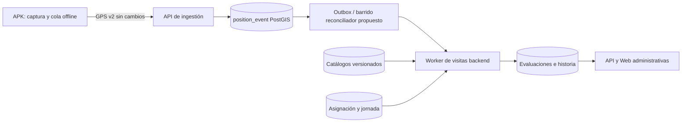

# Arquitectura y motor de permanencia

## Límites

El worker es un componente lógico separado del ciclo de petición. ADR-010 ya propone outbox transaccional, pero no hay tabla ni worker implementados en HEAD. En una primera wave, un barrido con watermark de `position_event` puede reconciliar asignaciones; antes de carga real, el trigger transaccional/outbox debe cerrar la ventana de pérdida entre ACK y encolado. Ninguna ruta de evaluación condiciona la captura en Android.

## Comparación de estimadores

| Alternativa | Ventaja | Riesgo/decisión |
| --- | --- | --- |
| Muestra = cadencia nominal | Fácil | Falsa permanencia ante pausas, descarte o falta de GPS. Rechazada. |
| Todo intervalo entre dos puntos interiores | Mayor sensibilidad | Salida y retorno invisibles; huecos offline cuentan falsamente. Rechazada. |
| Interpolación de trayectoria | Geometría continua | Trayectoria inventada; imprecisión cerca del borde. No apta como hecho. |
| Pares cercanos de puntos interiores de buena calidad con crédito acotado | Determinista, auditable, tolera huecos | Subestima visitas con señal irregular; parámetros requieren piloto físico. **Propuesta.** |

## Algoritmo propuesto, versión de regla `dwell-v1`

1. Por cada `assignment_visit`, cargar snapshot de geozona, tiempo requerido, jornada UTC derivada de fecha local/zona IANA y vínculo agente–dispositivo válido por tiempo. Intersectar con ventanas `gps_scheduled_session` y `gps_effective_session` autorizadas. No se incorporan eventos posteriores al fin de jornada ni del siguiente día.
2. Consultar `position_event` del tenant/dispositivo en esa intersección. Deduplicar por PK `(device_id,event_id)`; ordenar por `(captured_at,event_id)`. Verificar calidad, sesión, asignación del dispositivo y ancla. Marcar eventos con tiempo dudoso o cobertura de identidad ambigua como excluidos, con razón.
3. Para cada punto, calcular distancia geodésica en metros sobre `geography`. `INSIDE_CONFIDENT` si `distance_m + accuracy_m <= radius_m`; `OUTSIDE_CONFIDENT` si `distance_m - accuracy_m > radius_m`; de otro modo `AMBIGUOUS`. Precisión máxima aceptable se configura y calibra. El umbral de entrada/salida para UI puede tener histéresis, pero la acreditación usa la regla estricta y un solo punto no aporta duración.
4. Crear intervalos solo entre pares **consecutivos** de puntos `INSIDE_CONFIDENT` del mismo contexto histórico, con separación `0 < Δ <= max_gap_s`, sin evento ambiguo/exterior intermedio, misma sesión efectiva y movimiento plausible según umbral de velocidad. Para cada par, acreditar `max(0, min(Δ, credit_cap_s) - uncertainty_guard_s)`. `max_gap_s`, `credit_cap_s`, `uncertainty_guard_s`, precisión y velocidad son parámetros de regla versionada: deben medirse, no fijarse aquí. Intervalos disjuntos por construcción se recortan a la jornada. Un hueco mayor que `max_gap_s` aporta cero. Se almacena el par de IDs, tiempo observado `Δ`, crédito inferido y razón.
5. Sumar créditos de pares sin superposición dentro de la visita. La salida y reentrada no borran crédito anterior. `COMPLETED` al alcanzar el mínimo; `completed_at` es el instante **estimado** en el par que cruza el umbral, nunca una hora de llegada al servidor. `first_entry`/ `last_exit` son primeras/últimas observaciones calificadas o estimaciones etiquetadas; no hechos exactos de cruce.
6. Registrar `evaluation_version`, hash de fuentes y parámetros, resultados anteriores y estado de sincronización. Nueva evidencia tardía dispara recálculo completo de la visita en transacción serializada por visita; reemplaza proyección, agrega revisión de historia inmutable y conserva razones. Reenvío idéntico no crea nueva revisión.

La clasificación espacial usa PostGIS `ST_Distance(geography,geography)`; `ST_DWithin` y GiST sirven para prefiltrar, pero la evidencia se limita primero por dispositivo/tiempo/tenant. No se atribuye movimiento no observado como hecho. La fórmula produce **permanencia estimada corroborada**, no una cota matemática de presencia: una salida entre dos muestras puede seguir invisible. La fracción acreditada favorece evitar falsos positivos y puede aumentar falsos negativos. Calibrar con trazas físicas de interiores, bordes, cañones urbanos y reinicios antes de aprobar umbrales. Para `INCOMPLETE`/ `NOT_VISITED` se exige cobertura definida por proporción de ventanas observadas, máximos huecos, calidad y watermark; umbrales pendientes.

## Tiempo y concurrencia

### Integración Wave 4B local

`GpsDeviceScope` resuelve una instalación autenticada a un tenant. Con binding MDM activo conserva la ruta previa; sin binding exige `geops_device_tenant` inmutable e instalación GEOPS autorizada. Configuración, eventos y health comparten esta resolución. ACK y evaluador están desacoplados: un worker acotado reconcilia posiciones aceptadas, encola asignaciones y procesa con `SKIP LOCKED` y reintentos. El motor usa `agent_device_link` por `captured_at`, sesión efectiva/programada y snapshot de asignación. `TECHNICAL_ONLY` protege umbrales sintéticos; `LAB_ONLY` Wave 4A permanece.

### Implementación local Wave 4A

`dwell-pair-v1` revisión 1 implementa los pares interiores consecutivos descritos arriba. Los parámetros de `visit_algorithm_revision` son **solo de laboratorio**: separación y crédito máximo de 300 s, guardia 0 s, precisión máxima 25 m, tolerancia de borde 0 m y velocidad máxima 50 m/s. El worker rechaza esta revisión fuera de `GEOPS_DATA_MODE=synthetic`. `ST_Distance` sobre `geography` calcula metros desde `assignment_visit`; la precisión completa se suma a la distancia al acreditar interior. Se trunca a segundos enteros para no acreditar fracciones no persistibles. Una muestra exterior o incierta, un cambio de vínculo, sesión, ancla o arranque, un evento de interrupción, velocidad imposible o hueco superior al máximo rompe el par. Una muestra sola acredita cero.

El API encola por asignación o fecha local (máximo 100 asignaciones), y el worker independiente procesa hasta 100 trabajos por invocación con `FOR UPDATE SKIP LOCKED`, máximo 5000 posiciones por visita, transacción y revisión append-only. El digest incluye snapshot, fase temporal, algoritmo, vínculos, posiciones, contexto y barreras; reejecución idéntica no añade historia. El paso de fase previa/activa/finalizada permite actualizar el estado aun sin GPS nuevo mediante reproceso. En modo sintético, un reconciliador acotado compara el número de posiciones persistidas dentro del vínculo/ventana con el número visto por el último job y encola evidencia nueva o tardía; se ejecuta antes de cada drenaje del worker. **No existe outbox conectado a la ingestión, proceso periódico desplegado ni mecanismo de activación para datos reales**. No se modifica ACK.

Un vínculo `visit_lab_agent_device_link` solo se carga directamente en una base sintética; no existe API para crearlo. Sin él, el resultado es `UNATTRIBUTABLE`. La sesión efectiva y programada debe cubrir el `captured_at` y coincidir en dispositivo, tenant y versión de asignación GPS. La relación física de identidad y el cambio MDM-free corresponden a Wave 4B. Para zonas compartidas, cada requisito puede usar el mismo intervalo corroborado; `physical_credited_s` es la unión temporal y `visit_credited_sum_s` suma créditos por requisito. El primero no multiplica segundos físicos.

Cada asignación guarda zona IANA, fecha local y límites UTC ya resueltos. Una jornada que cruza medianoche conserva la fecha de inicio y no transfiere saldo a otra asignación. En días DST, usar la versión de base de zonas horarias y política explícita para hora local ambigua o inexistente; bloquear publicación si no puede resolverse unívocamente. Reasignar dispositivo cierra intervalo de vínculo y genera nueva evaluación solo del tramo correspondiente. Cuando dos geozonas se solapan, la misma evidencia podría acreditar ambas: política de negocio pendiente; el motor debe exponer coincidencia y no decidir por proximidad arbitraria.

## Seguridad y observabilidad

La API de administración reutiliza sesión, Origin/CSRF, capacidades y concesión tenant; se proponen `visit.catalog.read/write`, `visit.schedule.read/write`, `visit.result.read` y `visit.evidence.read` con concesión explícita. Las coordenadas solo se muestran para evidencia autorizada con motivo, paginación y auditoría. Métricas: backlog, antigüedad de evidencia, lag de evaluación, recalculaciones, muestras ambiguas, huecos, decisiones por regla y discrepancias de retención, sin etiquetas de coordenadas ni identificadores personales de alta cardinalidad.
# Wave 5 — lectura administrativa de cumplimiento

La API `/v1/admin/compliance` proyecta snapshots de asignaciones/paradas y la última evaluación persistida; no ejecuta `evaluateDwell` en la solicitud. Agrega KPI y grupos sobre la ventana acotada; lista y mapa paginan las mismas visitas. La identidad del agente es `agent`/`route_assignment`; las ubicaciones se atribuyen únicamente mediante `agent_device_link` válido al `captured_at` dentro de la jornada. Permisos independientes protegen resultados, vínculos, ACK/health y coordenadas. `gps_sync_status` describe sincronización observada, `visit_evaluation_job` describe procesamiento; no se equiparan. La revisión histórica enlaza causa auditable cuando fue registrada. Consultar [ADR-028](../architecture/adr/ADR-028-dashboard-cumplimiento-provisional-propuesto.md) y [cierre Wave 5](wave5-closure.md).
