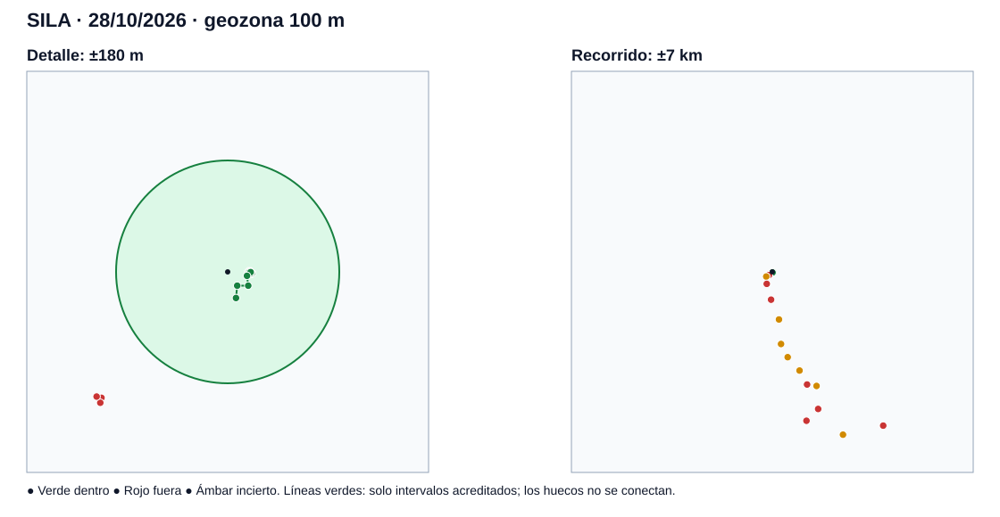
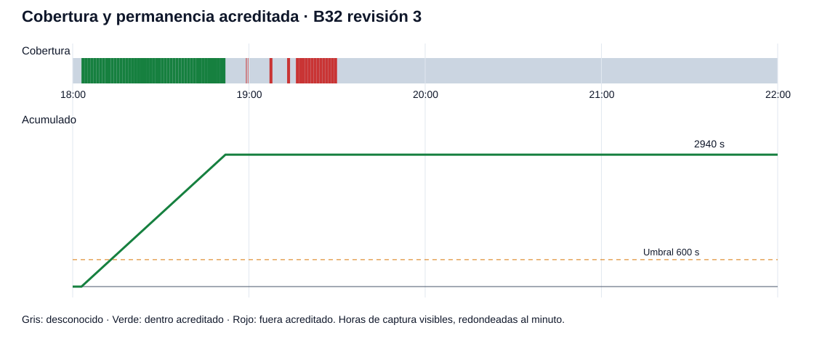

# GEOPS B32 · Simulación condicionada de SILA, 28/10/2026

## Alcance y procedencia

Se ejecutó la función real `evaluateDwell` de `apps/api/src/visit-dwell-engine.ts`, en modo local y de solo lectura, con las **77 filas que el usuario pegó en esta conversación**. El texto original de esas filas tiene SHA-256 `1918b0fab87bf1045ace7e0db3cd3711b2d4fd9d62cb5274e18fa7a056aec137` (UTF-8, saltos LF, sin salto final). La tabla contiene captura, recepción, retraso, precisión, etiqueta de sesión y coordenadas. Las capturas visibles van de 18:03 a 19:30; las recepciones visibles van de 18:08 a 19:32. La precisión informada va de 4.10 a 1000.00 m. No se consultó ni modificó ninguna base de producción o staging. Las distancias al centro y entre puntos consecutivos se calcularon con `ST_Distance(geography, geography)` en PostGIS 18/3.6, en un contenedor temporal aislado y eliminado al terminar; no se crearon tablas. Las 77 distancias derivadas se conservan en `b32-sila-visit-postgis-distances-2026-10-28.csv`; el ejecutor reproducible está en `apps/api/scripts/simulate-sila-visit.mjs`. El texto GPS original permanece en el mensaje del usuario, no se agregó como archivo de datos al repositorio.

**Límite de procedencia:** esta exportación de interfaz muestra la hora solo hasta el minuto; no incluye `event_id`, `device_id`, vínculo agente/dispositivo, `boot_id`, `capture_anchor_id`, `payload_digest` original, `quality_state` ni eventos `INTERRUPTED/STOPPED/RESUMED` con hora. El motor exige esos campos. Para el replay se usaron índices de fila deterministas como identificadores técnicos, una misma identidad/vínculo/ancla/arranque supuestos, `qualityState=DEVICE_REPORTED` y ninguna barrera. **Son hipótesis, no hechos verificados.** El rótulo visual `STOPPED` identifica el estado final de sesión, no demuestra cuándo ocurrió la parada. La simulación es condicional y no equivale a la consulta operacional del servicio, que filtra además por vínculo y sesiones efectivas/programadas.

## Geozona, ventana y regla

- Centro provisto: latitud 10.329042, longitud -84.429728; círculo de 100 m, revisión histórica declarada 1. El snapshot de la asignación no está en la exportación y **no pudo verificarse** contra la base.
- Ventana provista: 28/10/2026 18:00–22:00 `America/Guatemala`, equivalente en la simulación a 29/10/2026 00:00–04:00 UTC. Se comprobó la conversión con `Intl.DateTimeFormat`. Todas las 77 capturas visibles caen en esa ventana; recepción no se usó para acreditar tiempo.
- Requisito: 600 segundos acumulados. Revisión técnica 3 `dwell-pair-v1`, alcance `TECHNICAL_ONLY`, decisiones `DEC-VISIT-001/002`. Parámetros verificados contra migraciones 0027 y 0033: `max_gap_s=300`, `credit_cap_s=300`, `uncertainty_guard_s=0`, `max_accuracy_m=25`, `boundary_tolerance_m=0`, `max_speed_m_s=50`, `coverage_min_fraction=null`, `non_compliance_enabled=false`.
- Se acreditan pares de posiciones con ambas clasificaciones `INSIDE`, igual identidad y sesión, sin barrera, velocidad aceptable y hueco dentro del límite. `INSIDE` requiere `distancia + precisión <= 100 m`. El tiempo fuera se limita a márgenes físicamente alcanzables; el resto es desconocido. No se dio crédito a tramos sin datos.

## Resultado

| Métrica | Resultado del escenario A |
|---|---:|
| Posiciones procesadas | 77 |
| Posiciones dentro / fuera / inciertas | 45 / 24 / 8 |
| Tiempo dentro acreditado | 2940 s (49.00 min) |
| Tiempo fuera acreditado | 984 s (16.40 min) |
| Tiempo desconocido en toda la ventana | 10476 s (174.60 min) |
| Cobertura GPS demostrada de 18:00–22:00 | 27.25% |
| Huecos >300 s detectados por el motor | 0 |
| Permanencia requerida | 600 s (10 min) |
| Resultado matemático B32, **bajo hipótesis explícitas** | COMPLETED |
| Primer instante estimado de completar 600 s (minutos visibles) | 18:13 |

La serie próxima al centro desde 18:03 aporta más de 600 s en el replay. Los tiempos visibles están redondeados al minuto: el instante exacto de completar no se puede fijar a segundos. Del primer punto de 18:03 al de 18:15 transcurren **más de 660 s** aun tomando los extremos posibles de sus minutos visibles; todos esos puntos se clasifican dentro con los parámetros A y los huecos visibles no superan 2 min. Esa es una cota de tiempo transcurrido, no una acreditación exacta: faltan los segundos originales y las pruebas de continuidad/identidad que usa el servicio. No se equiparan minutos transcurridos con tiempo automáticamente acreditado.

La zona horaria `America/Guatemala` fue provista como parte de la asignación; el archivo no tiene offset explícito. El retraso de sincronización se muestra en la fuente, pero la permanencia depende de captura, no de recepción. La precisión `±m` se interpretó como radio horizontal informado; algunos registros marcados `baja` superan 25 m y quedan inciertos.

## Comparación de escenarios

Los escenarios B y C son exploratorios. Cambian solo los parámetros indicados; mantienen el mismo conjunto de 77 filas y las mismas hipótesis de identidad/calidad. En B se exige mayor precisión, hueco menor y se descuenta 10 s por par. Al reducir `max_gap_s`, `credit_cap_s` se reduce al mismo valor porque el validador B32 lo exige.

| Escenario | Hueco/tope | Precisión máx. | Reserva/par | Dentro | Fuera | Desconocido | Cobertura | Estado del motor |
|---|---:|---:|---:|---:|---:|---:|---:|---:|
| A · B32 revision 3 | 300/300 s | 25 m | 0 s | 2940 s (49.00 min) | 984 s (16.40 min) | 10476 s (174.60 min) | 27.25% | COMPLETED |
| B · conservador exploratorio | 120/120 s | 20 m | 10 s | 2390 s (39.83 min) | 907 s (15.12 min) | 11103 s (185.05 min) | 22.9% | COMPLETED |
| C1 · gap 60 s | 60/60 s | 25 m | 0 s | 2340 s (39.00 min) | 864 s (14.40 min) | 11196 s (186.60 min) | 22.25% | COMPLETED |
| C2 · gap 120 s | 120/120 s | 25 m | 0 s | 2940 s (49.00 min) | 984 s (16.40 min) | 10476 s (174.60 min) | 27.25% | COMPLETED |
| C3 · precisión 15 m | 300/300 s | 15 m | 0 s | 420 s (7.00 min) | 84 s (1.40 min) | 13896 s (231.60 min) | 3.5% | INSUFFICIENT_EVIDENCE |
| C4 · precisión 20 m | 300/300 s | 20 m | 0 s | 2820 s (47.00 min) | 924 s (15.40 min) | 10656 s (177.60 min) | 26% | COMPLETED |
| C5 · precisión 30 m | 300/300 s | 30 m | 0 s | 2940 s (49.00 min) | 1104 s (18.40 min) | 10356 s (172.60 min) | 28.08% | COMPLETED |

La revisión 3 no tiene aún umbral `coverage_min_fraction` calibrado ni habilita `non_compliance_enabled`; por eso no puede emitir `INCOMPLETE` como conclusión de incumplimiento. Los límites numéricos actuales (hueco, precisión, velocidad y reserva cero) siguen sin validación de campo para esta sede. Un resultado favorable no aprueba esos límites ni activa la revisión.

La sensibilidad a la precisión es material: con un máximo exploratorio de **15 m**, el motor acredita solo **420 s (7 min)** y devuelve `INSUFFICIENT_EVIDENCE`; con 20 m acredita 2820 s. Esto refuerza la necesidad de calibrar el umbral con datos de campo antes de cualquier promoción.

## Evidencia visual

El mapa une exclusivamente pares acreditados dentro; los huecos y tramos inciertos quedan sin línea. La cobertura del gráfico se refiere a las cuatro horas de la ventana autorizada, no solo al período entre primera y última captura.

## Intervalos del escenario A

Las horas son locales y visibles al minuto. Las distancias provienen de PostGIS, en metros. `Desconocido` en cada fila es el resto de ese intervalo tras acreditar dentro/fuera; además hay 9180 s (153.00 min) sin observación antes de la primera o después de la última captura dentro de la ventana. Las coordenadas y precisiones están expresadas como extremo inicial → final.

| Hora | Duración s | Coordenadas (lat, lon) | Distancia m | Precisión m | Clase | Dentro s | Fuera s | Desconocido s | Motivo |
|---|---:|---|---|---|---|---:|---:|---:|---|
| 18:03–18:04 | 60 | 10.32904, -84.42954 → 10.32904, -84.42954 | 20.59 → 20.59 | 16.79 → 15.03 | INSIDE → INSIDE | 60 | 0 | 0 | Acreditado dentro: par válido B32 |
| 18:04–18:05 | 60 | 10.32904, -84.42954 → 10.32904, -84.42955 | 20.59 → 19.50 | 15.03 → 13.99 | INSIDE → INSIDE | 60 | 0 | 0 | Acreditado dentro: par válido B32 |
| 18:05–18:06 | 60 | 10.32904, -84.42955 → 10.32903, -84.42953 | 19.50 → 21.73 | 13.99 → 13.92 | INSIDE → INSIDE | 60 | 0 | 0 | Acreditado dentro: par válido B32 |
| 18:06–18:07 | 60 | 10.32903, -84.42953 → 10.32904, -84.42955 | 21.73 → 19.50 | 13.92 → 15.71 | INSIDE → INSIDE | 60 | 0 | 0 | Acreditado dentro: par válido B32 |
| 18:07–18:08 | 60 | 10.32904, -84.42955 → 10.32903, -84.42954 | 19.50 → 20.63 | 15.71 → 15.86 | INSIDE → INSIDE | 60 | 0 | 0 | Acreditado dentro: par válido B32 |
| 18:08–18:09 | 60 | 10.32903, -84.42954 → 10.32904, -84.42956 | 20.63 → 18.40 | 15.86 → 15.06 | INSIDE → INSIDE | 60 | 0 | 0 | Acreditado dentro: par válido B32 |
| 18:09–18:10 | 60 | 10.32904, -84.42956 → 10.32903, -84.42955 | 18.40 → 19.54 | 15.06 → 14.38 | INSIDE → INSIDE | 60 | 0 | 0 | Acreditado dentro: par válido B32 |
| 18:10–18:11 | 60 | 10.32903, -84.42955 → 10.32905, -84.42955 | 19.54 → 19.52 | 14.38 → 15.55 | INSIDE → INSIDE | 60 | 0 | 0 | Acreditado dentro: par válido B32 |
| 18:11–18:13 | 120 | 10.32905, -84.42955 → 10.32904, -84.42954 | 19.52 → 20.59 | 15.55 → 14.10 | INSIDE → INSIDE | 120 | 0 | 0 | Acreditado dentro: par válido B32 |
| 18:13–18:14 | 60 | 10.32904, -84.42954 → 10.32904, -84.42955 | 20.59 → 19.50 | 14.10 → 12.36 | INSIDE → INSIDE | 60 | 0 | 0 | Acreditado dentro: par válido B32 |
| 18:14–18:15 | 60 | 10.32904, -84.42955 → 10.32904, -84.42956 | 19.50 → 18.40 | 12.36 → 16.77 | INSIDE → INSIDE | 60 | 0 | 0 | Acreditado dentro: par válido B32 |
| 18:15–18:16 | 60 | 10.32904, -84.42956 → 10.32904, -84.42954 | 18.40 → 20.59 | 16.77 → 14.65 | INSIDE → INSIDE | 60 | 0 | 0 | Acreditado dentro: par válido B32 |
| 18:16–18:17 | 60 | 10.32904, -84.42954 → 10.32903, -84.42954 | 20.59 → 20.63 | 14.65 → 16.13 | INSIDE → INSIDE | 60 | 0 | 0 | Acreditado dentro: par válido B32 |
| 18:17–18:18 | 60 | 10.32903, -84.42954 → 10.32904, -84.42954 | 20.63 → 20.59 | 16.13 → 15.23 | INSIDE → INSIDE | 60 | 0 | 0 | Acreditado dentro: par válido B32 |
| 18:18–18:19 | 60 | 10.32904, -84.42954 → 10.32904, -84.42956 | 20.59 → 18.40 | 15.23 → 14.62 | INSIDE → INSIDE | 60 | 0 | 0 | Acreditado dentro: par válido B32 |
| 18:19–18:20 | 60 | 10.32904, -84.42956 → 10.32903, -84.42954 | 18.40 → 20.63 | 14.62 → 20.00 | INSIDE → INSIDE | 60 | 0 | 0 | Acreditado dentro: par válido B32 |
| 18:20–18:21 | 60 | 10.32903, -84.42954 → 10.32903, -84.42954 | 20.63 → 20.63 | 20.00 → 15.46 | INSIDE → INSIDE | 60 | 0 | 0 | Acreditado dentro: par válido B32 |
| 18:21–18:22 | 60 | 10.32903, -84.42954 → 10.32903, -84.42953 | 20.63 → 21.73 | 15.46 → 15.35 | INSIDE → INSIDE | 60 | 0 | 0 | Acreditado dentro: par válido B32 |
| 18:22–18:23 | 60 | 10.32903, -84.42953 → 10.32904, -84.42954 | 21.73 → 20.59 | 15.35 → 14.27 | INSIDE → INSIDE | 60 | 0 | 0 | Acreditado dentro: par válido B32 |
| 18:23–18:24 | 60 | 10.32904, -84.42954 → 10.32904, -84.42955 | 20.59 → 19.50 | 14.27 → 15.10 | INSIDE → INSIDE | 60 | 0 | 0 | Acreditado dentro: par válido B32 |
| 18:24–18:25 | 60 | 10.32904, -84.42955 → 10.32904, -84.42955 | 19.50 → 19.50 | 15.10 → 15.29 | INSIDE → INSIDE | 60 | 0 | 0 | Acreditado dentro: par válido B32 |
| 18:25–18:26 | 60 | 10.32904, -84.42955 → 10.32904, -84.42955 | 19.50 → 19.50 | 15.29 → 14.53 | INSIDE → INSIDE | 60 | 0 | 0 | Acreditado dentro: par válido B32 |
| 18:26–18:27 | 60 | 10.32904, -84.42955 → 10.32904, -84.42955 | 19.50 → 19.50 | 14.53 → 14.16 | INSIDE → INSIDE | 60 | 0 | 0 | Acreditado dentro: par válido B32 |
| 18:27–18:28 | 60 | 10.32904, -84.42955 → 10.32904, -84.42954 | 19.50 → 20.59 | 14.16 → 14.69 | INSIDE → INSIDE | 60 | 0 | 0 | Acreditado dentro: par válido B32 |
| 18:28–18:30 | 120 | 10.32904, -84.42954 → 10.32904, -84.42954 | 20.59 → 20.59 | 14.69 → 16.48 | INSIDE → INSIDE | 120 | 0 | 0 | Acreditado dentro: par válido B32 |
| 18:30–18:31 | 60 | 10.32904, -84.42954 → 10.32904, -84.42955 | 20.59 → 19.50 | 16.48 → 14.75 | INSIDE → INSIDE | 60 | 0 | 0 | Acreditado dentro: par válido B32 |
| 18:31–18:32 | 60 | 10.32904, -84.42955 → 10.32903, -84.42953 | 19.50 → 21.73 | 14.75 → 17.89 | INSIDE → INSIDE | 60 | 0 | 0 | Acreditado dentro: par válido B32 |
| 18:32–18:33 | 60 | 10.32903, -84.42953 → 10.32904, -84.42954 | 21.73 → 20.59 | 17.89 → 15.07 | INSIDE → INSIDE | 60 | 0 | 0 | Acreditado dentro: par válido B32 |
| 18:33–18:34 | 60 | 10.32904, -84.42954 → 10.32904, -84.42954 | 20.59 → 20.59 | 15.07 → 14.45 | INSIDE → INSIDE | 60 | 0 | 0 | Acreditado dentro: par válido B32 |
| 18:34–18:35 | 60 | 10.32904, -84.42954 → 10.32904, -84.42955 | 20.59 → 19.50 | 14.45 → 15.56 | INSIDE → INSIDE | 60 | 0 | 0 | Acreditado dentro: par válido B32 |
| 18:35–18:36 | 60 | 10.32904, -84.42955 → 10.32904, -84.42954 | 19.50 → 20.59 | 15.56 → 13.46 | INSIDE → INSIDE | 60 | 0 | 0 | Acreditado dentro: par válido B32 |
| 18:36–18:37 | 60 | 10.32904, -84.42954 → 10.32904, -84.42954 | 20.59 → 20.59 | 13.46 → 14.00 | INSIDE → INSIDE | 60 | 0 | 0 | Acreditado dentro: par válido B32 |
| 18:37–18:38 | 60 | 10.32904, -84.42954 → 10.32904, -84.42955 | 20.59 → 19.50 | 14.00 → 16.41 | INSIDE → INSIDE | 60 | 0 | 0 | Acreditado dentro: par válido B32 |
| 18:38–18:39 | 60 | 10.32904, -84.42955 → 10.32904, -84.42954 | 19.50 → 20.59 | 16.41 → 15.30 | INSIDE → INSIDE | 60 | 0 | 0 | Acreditado dentro: par válido B32 |
| 18:39–18:40 | 60 | 10.32904, -84.42954 → 10.32903, -84.42953 | 20.59 → 21.73 | 15.30 → 15.38 | INSIDE → INSIDE | 60 | 0 | 0 | Acreditado dentro: par válido B32 |
| 18:40–18:41 | 60 | 10.32903, -84.42953 → 10.32904, -84.42954 | 21.73 → 20.59 | 15.38 → 16.23 | INSIDE → INSIDE | 60 | 0 | 0 | Acreditado dentro: par válido B32 |
| 18:41–18:42 | 60 | 10.32904, -84.42954 → 10.32904, -84.42954 | 20.59 → 20.59 | 16.23 → 13.77 | INSIDE → INSIDE | 60 | 0 | 0 | Acreditado dentro: par válido B32 |
| 18:42–18:44 | 120 | 10.32904, -84.42954 → 10.32903, -84.42954 | 20.59 → 20.63 | 13.77 → 20.00 | INSIDE → INSIDE | 120 | 0 | 0 | Acreditado dentro: par válido B32 |
| 18:44–18:45 | 60 | 10.32903, -84.42954 → 10.32904, -84.42955 | 20.63 → 19.50 | 20.00 → 13.08 | INSIDE → INSIDE | 60 | 0 | 0 | Acreditado dentro: par válido B32 |
| 18:45–18:46 | 60 | 10.32904, -84.42955 → 10.32904, -84.42954 | 19.50 → 20.59 | 13.08 → 16.70 | INSIDE → INSIDE | 60 | 0 | 0 | Acreditado dentro: par válido B32 |
| 18:46–18:48 | 120 | 10.32904, -84.42954 → 10.32901, -84.42957 | 20.59 → 17.66 | 16.70 → 8.40 | INSIDE → INSIDE | 120 | 0 | 0 | Acreditado dentro: par válido B32 |
| 18:48–18:49 | 60 | 10.32901, -84.42957 → 10.32893, -84.42956 | 17.66 → 22.18 | 8.40 → 4.10 | INSIDE → INSIDE | 60 | 0 | 0 | Acreditado dentro: par válido B32 |
| 18:49–18:50 | 60 | 10.32893, -84.42956 → 10.32893, -84.42965 | 22.18 → 15.05 | 4.10 → 6.20 | INSIDE → INSIDE | 60 | 0 | 0 | Acreditado dentro: par válido B32 |
| 18:50–18:52 | 120 | 10.32893, -84.42965 → 10.32883, -84.42966 | 15.05 → 24.60 | 6.20 → 21.11 | INSIDE → INSIDE | 120 | 0 | 0 | Acreditado dentro: par válido B32 |
| 18:52–18:53 | 60 | 10.32883, -84.42966 → 10.32802, -84.43076 | 24.60 → 159.86 | 21.11 → 13.04 | INSIDE → OUTSIDE | 0 | 0 | 60 | Desconocido: extremos de distinta clase o inciertos |
| 18:53–18:55 | 120 | 10.32802, -84.43076 → 10.32798, -84.43077 | 159.86 → 163.78 | 13.04 → 14.29 | OUTSIDE → OUTSIDE | 0 | 0 | 120 | Fuera observado; sin segundos demostrables |
| 18:55–18:56 | 60 | 10.32798, -84.43077 → 10.32803, -84.43080 | 163.78 → 162.22 | 14.29 → 12.66 | OUTSIDE → OUTSIDE | 0 | 0 | 60 | Fuera observado; sin segundos demostrables |
| 18:56–18:58 | 120 | 10.32803, -84.43080 → 10.32757, -84.43166 | 162.22 → 267.00 | 12.66 → 36.56 | OUTSIDE → UNCERTAIN | 0 | 0 | 120 | Desconocido: extremos de distinta clase o inciertos |
| 18:58–18:59 | 60 | 10.32757, -84.43166 → 10.32526, -84.43150 | 267.00 → 461.16 | 36.56 → 7.70 | UNCERTAIN → OUTSIDE | 0 | 0 | 60 | Desconocido: extremos de distinta clase o inciertos |
| 18:59–19:00 | 60 | 10.32526, -84.43150 → 10.32027, -84.43012 | 461.16 → 971.22 | 7.70 → 6.80 | OUTSIDE → OUTSIDE | 0 | 24 | 36 | Fuera: margen alcanzable de extremos |
| 19:00–19:01 | 60 | 10.32027, -84.43012 → 10.31402, -84.42761 | 971.22 → 1677.70 | 6.80 → 122.25 | OUTSIDE → UNCERTAIN | 0 | 0 | 60 | Desconocido: extremos de distinta clase o inciertos |
| 19:01–19:02 | 60 | 10.31402, -84.42761 → 10.30628, -84.42695 | 1677.70 → 2536.02 | 122.25 → 300.00 | UNCERTAIN → UNCERTAIN | 0 | 0 | 60 | Desconocido: extremos de distinta clase o inciertos |
| 19:02–19:03 | 60 | 10.30628, -84.42695 → 10.30212, -84.42484 | 2536.02 → 3025.59 | 300.00 → 36.90 | UNCERTAIN → UNCERTAIN | 0 | 0 | 60 | Desconocido: extremos de distinta clase o inciertos |
| 19:03–19:04 | 60 | 10.30212, -84.42484 → 10.29790, -84.42107 | 3025.59 → 3572.77 | 36.90 → 47.65 | UNCERTAIN → UNCERTAIN | 0 | 0 | 60 | Desconocido: extremos de distinta clase o inciertos |
| 19:04–19:05 | 60 | 10.29790, -84.42107 → 10.29350, -84.41867 | 3572.77 → 4113.65 | 47.65 → 5.40 | UNCERTAIN → OUTSIDE | 0 | 0 | 60 | Desconocido: extremos de distinta clase o inciertos |
| 19:05–19:06 | 60 | 10.29350, -84.41867 → 10.29304, -84.41566 | 4113.65 → 4269.91 | 5.40 → 128.90 | OUTSIDE → UNCERTAIN | 0 | 0 | 60 | Desconocido: extremos de distinta clase o inciertos |
| 19:06–19:07 | 60 | 10.29304, -84.41566 → 10.28578, -84.41515 | 4269.91 → 5044.59 | 128.90 → 5.80 | UNCERTAIN → OUTSIDE | 0 | 0 | 60 | Desconocido: extremos de distinta clase o inciertos |
| 19:07–19:08 | 60 | 10.28578, -84.41515 → 10.28206, -84.41887 | 5044.59 → 5331.03 | 5.80 → 14.10 | OUTSIDE → OUTSIDE | 0 | 60 | 0 | Fuera: margen alcanzable de extremos |
| 19:08–19:10 | 120 | 10.28206, -84.41887 → 10.27766, -84.40725 | 5331.03 → 6193.76 | 14.10 → 1000.00 | OUTSIDE → UNCERTAIN | 0 | 0 | 120 | Desconocido: extremos de distinta clase o inciertos |
| 19:10–19:13 | 180 | 10.27766, -84.40725 → 10.28052, -84.39446 | 6193.76 → 6612.74 | 1000.00 → 24.15 | UNCERTAIN → OUTSIDE | 0 | 0 | 180 | Desconocido: extremos de distinta clase o inciertos |
| 19:13–19:14 | 60 | 10.28052, -84.39446 → 10.28052, -84.39446 | 6612.74 → 6612.74 | 24.15 → 20.00 | OUTSIDE → OUTSIDE | 0 | 60 | 0 | Fuera: margen alcanzable de extremos |
| 19:14–19:15 | 60 | 10.28052, -84.39446 → 10.28050, -84.39446 | 6612.74 → 6614.54 | 20.00 → 26.40 | OUTSIDE → UNCERTAIN | 0 | 0 | 60 | Desconocido: extremos de distinta clase o inciertos |
| 19:15–19:16 | 60 | 10.28050, -84.39446 → 10.28052, -84.39446 | 6614.54 → 6612.74 | 26.40 → 20.00 | UNCERTAIN → OUTSIDE | 0 | 0 | 60 | Desconocido: extremos de distinta clase o inciertos |
| 19:16–19:17 | 60 | 10.28052, -84.39446 → 10.28052, -84.39446 | 6612.74 → 6612.74 | 20.00 → 20.00 | OUTSIDE → OUTSIDE | 0 | 60 | 0 | Fuera: margen alcanzable de extremos |
| 19:17–19:19 | 120 | 10.28052, -84.39446 → 10.28052, -84.39446 | 6612.74 → 6612.74 | 20.00 → 20.00 | OUTSIDE → OUTSIDE | 0 | 120 | 0 | Fuera: margen alcanzable de extremos |
| 19:19–19:20 | 60 | 10.28052, -84.39446 → 10.28052, -84.39446 | 6612.74 → 6612.74 | 20.00 → 20.00 | OUTSIDE → OUTSIDE | 0 | 60 | 0 | Fuera: margen alcanzable de extremos |
| 19:20–19:21 | 60 | 10.28052, -84.39446 → 10.28052, -84.39446 | 6612.74 → 6612.74 | 20.00 → 20.00 | OUTSIDE → OUTSIDE | 0 | 60 | 0 | Fuera: margen alcanzable de extremos |
| 19:21–19:22 | 60 | 10.28052, -84.39446 → 10.28052, -84.39446 | 6612.74 → 6612.74 | 20.00 → 20.00 | OUTSIDE → OUTSIDE | 0 | 60 | 0 | Fuera: margen alcanzable de extremos |
| 19:22–19:23 | 60 | 10.28052, -84.39446 → 10.28052, -84.39446 | 6612.74 → 6612.74 | 20.00 → 20.00 | OUTSIDE → OUTSIDE | 0 | 60 | 0 | Fuera: margen alcanzable de extremos |
| 19:23–19:24 | 60 | 10.28052, -84.39446 → 10.28052, -84.39446 | 6612.74 → 6612.74 | 20.00 → 20.00 | OUTSIDE → OUTSIDE | 0 | 60 | 0 | Fuera: margen alcanzable de extremos |
| 19:24–19:25 | 60 | 10.28052, -84.39446 → 10.28052, -84.39446 | 6612.74 → 6612.74 | 20.00 → 20.00 | OUTSIDE → OUTSIDE | 0 | 60 | 0 | Fuera: margen alcanzable de extremos |
| 19:25–19:26 | 60 | 10.28052, -84.39446 → 10.28052, -84.39446 | 6612.74 → 6612.74 | 20.00 → 20.00 | OUTSIDE → OUTSIDE | 0 | 60 | 0 | Fuera: margen alcanzable de extremos |
| 19:26–19:27 | 60 | 10.28052, -84.39446 → 10.28052, -84.39446 | 6612.74 → 6612.74 | 20.00 → 20.00 | OUTSIDE → OUTSIDE | 0 | 60 | 0 | Fuera: margen alcanzable de extremos |
| 19:27–19:28 | 60 | 10.28052, -84.39446 → 10.28052, -84.39446 | 6612.74 → 6612.74 | 20.00 → 20.00 | OUTSIDE → OUTSIDE | 0 | 60 | 0 | Fuera: margen alcanzable de extremos |
| 19:28–19:29 | 60 | 10.28052, -84.39446 → 10.28052, -84.39446 | 6612.74 → 6612.74 | 20.00 → 20.00 | OUTSIDE → OUTSIDE | 0 | 60 | 0 | Fuera: margen alcanzable de extremos |
| 19:29–19:30 | 60 | 10.28052, -84.39446 → 10.28052, -84.39446 | 6612.74 → 6612.74 | 20.00 → 20.00 | OUTSIDE → OUTSIDE | 0 | 60 | 0 | Fuera: margen alcanzable de extremos |

## Validaciones y recomendación

- Los 77 registros de la fuente se procesaron una vez, ordenados por captura; no hay dos filas con la misma marca visible. El motor eliminó duplicados por la clave técnica, y la unión de segundos físicos acreditados coincide con `2940` s: no hay doble conteo.
- La segunda ejecución de `evaluateDwell` produjo exactamente el mismo JSON. Distancias calculadas por PostGIS con el centro y coordenadas suministrados. No se sustituyeron posiciones faltantes.
- No se pudo verificar el vínculo del dispositivo con AGT-001, el snapshot histórico, los estados `quality_state`, las horas exactas de captura, las barreras de sesión ni el acceso que habría tenido la consulta operacional. Por ello la simulación demuestra **cumplimiento condicional** de los 10 minutos, pero no prueba que el dispositivo vinculado cumplió oficialmente.
- Para resolver la visita real, obtener del sistema el snapshot de asignación y una exportación de `position_event` con identificadores, calidad, segundos/milisegundos y los eventos de sesión; entonces repetir el motor con la consulta operacional y una revisión aprobada. Conservar la revisión 3 desactivada hasta calibración y aprobación.

**SIMULATION_RESULT = COMPLIANT**

Esta clasificación describe únicamente el replay condicionado. **REAL_VISIT_EVIDENCE = INSUFFICIENT_EVIDENCE** mientras no se verifiquen identidad, snapshot, calidad y barreras.

**OFFICIAL_EVALUATION = NOT_EXECUTED**

**DATA_MODIFIED = NO**

**RULE_3_ACTIVATED = NO**
