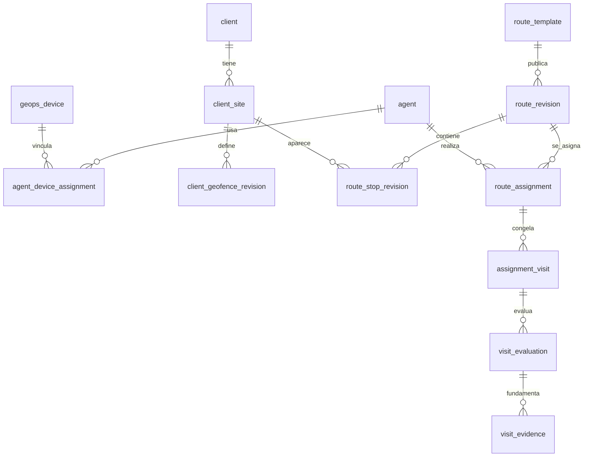

# Modelo de datos propuesto

**Convenciones:** UUID internos; `tenant_id` en toda entidad comercial; `created_at/updated_at` UTC; hora local y zona IANA para calendario; FK compuestas con `tenant_id` para impedir cruces entre tenants. El diagrama completo es conceptual; solo Wave 1/2 tienen migraciones locales probadas en DB descartable. El `customer_id` de `mdm_binding` es tenant MDM, distinto de `client.code`.

| Entidad | Columnas esenciales, claves y reglas |
| --- | --- |
| `agent` | PK `id`, `tenant_id`, `agent_code`, nombre visible, estado, fechas. UNIQUE `(tenant_id,agent_code)`. No equivale a `admin_user`. Desactivar preserva historial. |
| `agent_device_assignment` | PK, `agent_id`, `device_id`, `tenant_id`, `valid_range tstzrange`, autor/motivo. EXCLUDE GiST: mismo dispositivo no tiene dos agentes en tiempos superpuestos; definir también conflicto de un agente con dos dispositivos según política. FK a `geops_device`. |
| `client` | PK, tenant, código normalizado, nombre, dirección, contacto opcional, estado, versión, autor/fechas. UNIQUE código activo e histórico por tenant; desactivación lógica. |
| `client_site` | PK, cliente/tenant, código sede, dirección, centro nominal, estado. UNIQUE `(client_id,site_code)`. Permite varias ubicaciones sin duplicar persona comercial. |
| `client_geofence_revision` | PK `(site_id,revision)`, centro `geography(Point,4326)`, radio positivo, `min_dwell_s`, `effective_range`, estado, autor/motivo, fecha. Revisiones publicadas inmutables y sin solape de vigencia por sede. GiST en centro; CHECK lat/lon válidos, radio y dwell dentro de límites configurables aprobados. Versión no altera asignación ya creada. |
| `route_template` | PK, tenant, código UNIQUE, nombre, descripción, estado, versión optimista, fechas/autor. |
| `route_revision` | PK `(route_id,revision)`, fecha publicación, autor, hash de contenido, duración estimada, estado. Inmutable. |
| `route_stop_revision` | PK `(route_id,revision,stop_id)`, `site_id`, obligatoria, orden sugerido nullable, dwell override nullable, revisión de geozona seleccionada. UNIQUE `(route_id,revision,site_id)` por defecto; si se admiten dos obligaciones distintas en la misma sede, requiere regla explícita. Sin FK a versión actual mutable. |
| `route_schedule_rule` | PK, ruta/revisión, agente, zona IANA, días ISO, horario local, rango de vigencia, excepciones, estado, versión; regla estable, ocurrencias materializadas hasta horizonte controlado. UNIQUE de `(rule_id,local_date)` en ocurrencia; excepciones con motivo. |
| `route_assignment` | PK, tenant, agente, dispositivo nullable, ruta/revisión, `local_date`, zona, `work_range tstzrange`, estado, origen regla/ocurrencia, `snapshot_hash`, autor/motivo. EXCLUDE GiST por agente y jornada para asignaciones activas; solape de dispositivo sujeto a vínculo. Cancelar/reasignar con eventos y nueva asignación, no mutar historia completada. |
| `assignment_visit` | PK, assignment, stop_id, client/site, geofence `site_id+revision` y snapshot de centro/radio, dwell requerido, obligatoria, estado proyección. UNIQUE `(assignment_id,stop_id)`. Snapshot/hash protege contra cambio de plantilla y purga de catálogo. |
| `visit_evaluation` | PK, visita, número de evaluación, algoritmo/regla, `source_digest`, cobertura, dwell acreditado/requerido, porcentaje limitado a 0–100, primer/último fix, `completed_at`, estado, sincronización, `evaluated_at`, `supersedes_id`, razón. UNIQUE `(visit_id,evaluation_no)` y `(visit_id,source_digest,rule_version)` para idempotencia. Append-only. |
| `visit_evidence` | PK evaluación + par de eventos, `device_id`, `event_id_a/b`, `[from,to)`, distancias/precisiones, `credited_s`, clasificación y motivo. FK `position_event(device_id,event_id)` mientras retención lo permita; política de referencia tras purga pendiente. UNIQUE `(evaluation_id,event_id_a,event_id_b)`. No copiar coordenadas crudas. |
| `visit_status_history` | PK, visita/evaluación, estado previo/nuevo, causa, `occurred_at`, actor o sistema, correlación. Append-only. |
| `visit_recompute_outbox` | PK, visita, watermark de evidencia, causa, `next_attempt_at`, intentos/lease. UNIQUE por visita+watermark; consumo al menos una vez con evaluación idempotente. ADR-010 es conceptual, no una tabla actual. |

**Índices sugeridos:** `client(tenant_id,code)`; `client_site(tenant_id,client_id)`; GiST `client_geofence_revision(center)`; `route_assignment(tenant_id,agent_id,local_date)`, `(tenant_id,route_id,local_date)`; GiST `work_range`; `assignment_visit(assignment_id,status)`; `visit_evaluation(visit_id,evaluation_no DESC)`; `visit_recompute_outbox(next_attempt_at)`. La consulta GPS reutiliza `position_event(tenant_id,device_id,captured_at DESC,event_id DESC)` de 0012.

**Versionado y migración:** 0016+ solo como número provisional, después de reconciliar migraciones del frente MDM. Secuencia aditiva: agente/vínculo; cliente/sede/revisión; ruta/revisión; asignación/snapshot; evaluación/outbox; capacidades nuevas y concesiones explícitas. Verificar checksums y DB real con gate de mantenimiento antes de cada wave. No renombrar `position_event`, `gps_scheduled_session`, `admin_permission` ni contratos GPS existentes. Backfill opcional solo con evidencia de titularidad histórica; nunca inferir agente a partir del dispositivo actual. Rollback por desactivar rutas/worker y conservar tablas; downgrade de migración aplicada requiere plan supervisado, nunca `DROP` automático.

**Retención:** no fijar retención de evaluaciones ni evidencia derivada hasta revisión de privacidad. La purga de posiciones a 90 días (`gps-event-service.ts:1024-1046`) rompe FKs directas si se conserva `visit_evidence`: usar identificadores minimizados sin FK bloqueante, o purgar/anonymizar evidencia en orden aprobado. Congelar solo métricas agregadas y hash de versión cuando la fuente expira; entonces reconstrucción detallada ya no es posible y debe indicarse.

## Implementación local Wave 2 — migración 0023

`route_template` conserva identidad, código único por tenant, estado lógico, versión optimista y número de revisión publicada. `route_draft_stop` es mutable por reemplazo atómico y exige una sede única por ruta; dos sedes del mismo cliente son dos paradas distintas. `route_revision` y `route_stop_revision` guardan metadatos y snapshots publicados: cliente y sede (códigos/nombres), centro/radio, revisión geozona, dwell heredado o sobrescrito, requisito de obligatoriedad y orden visual. El `content_hash` identifica el contenido exacto. El número `(route_id,revision)` queda preparado como referencia estable para Wave 3; no existe tabla de asignaciones en Wave 2.

Las FKs compuestas incluyen tenant, ruta y sede; el guard SQL permite insertar paradas solo antes de sellar una revisión dentro de la transacción de publicación. Una vez `sealed=true`, no se puede actualizar, borrar ni añadir paradas. El borrador se vacía al publicar y una edición posterior crea un nuevo borrador; la revisión anterior permanece accesible. `min_dwell_override_s=NULL` significa herencia de `client_geofence_revision.min_dwell_s`; al publicar se persiste también `min_dwell_effective_s`. Publicar requiere al menos una parada obligatoria, sede/cliente activos y la última geozona activa seleccionada. No se permite la misma sede dos veces en una ruta; sí en rutas distintas. No hay dependencia nueva con MDM/GPS.

## Implementación local Wave 3 — migración 0024

`agent` es un catálogo independiente de `geops_device` y `mdm_binding`, con código único por tenant, estado lógico y versión. `route_assignment` fija agente, ruta y revisión publicada, fecha civil, zona IANA, intervalo UTC, origen, estado y huella; conserva nombre/código históricos. Una exclusión GiST impide intervalos solapados `PLANNED` del mismo agente, pero permite varias rutas por día en horarios distintos. `assignment_visit` copia cliente/sede, centro/radio, geozona, dwell, obligatoriedad y orden sugerido de la revisión sellada; un trigger prohíbe UPDATE/DELETE del snapshot.

`route_schedule_rule` conserva días ISO, vigencia y zona; `route_schedule_exception` identifica SKIP/CANCEL/REPLACE por fecha; `route_schedule_occurrence` registra versión aplicada y resultado para reejecución idempotente. Los cambios futuros cancelan asignaciones planificadas anteriores y crean otras conservando historia. `visit_schedule_idempotency` guarda respuesta de mutaciones por actor y clave. Las FKs incluyen tenant y revisión donde corresponde. La tabla conceptual `agent_device_assignment` **no se creó**: `geops_device` carece de tenant canónico verificable sin `mdm_binding`; su contrato y migración requieren resolución en el frente de identidad. El diagrama y las filas conceptuales previas describen el objetivo completo de SPEC-03, no entidades todas implementadas.

## Implementación local Wave 4A — migración 0025

`visit_algorithm_revision` guarda parámetros y ámbito `LAB_ONLY`/`APPROVED`; solo existe la revisión de laboratorio. `visit_lab_agent_device_link` contiene vínculo temporal sintético con exclusiones GiST por agente y dispositivo, sin relación con `mdm_binding` ni API de alta. `visit_evaluation_job` es cola por asignación y conserva `position_count` visto antes de evaluar para reconciliación posterior sin perder llegadas concurrentes; `visit_evaluation` agrega revisiones inmutables, digest de fuentes, estado y segundos; `visit_evaluation_current` apunta a la última; `visit_evaluation_interval` contiene solo IDs de eventos y tiempos acreditados, nunca coordenadas. Sus IDs de eventos no son FK a `position_event` para no impedir la purga GPS. Triggers prohíben UPDATE/DELETE de versiones de algoritmo, vínculos sintéticos históricos, evaluaciones e intervalos. La consulta usa índices GPS existentes por tenant/dispositivo/tiempo, más índices de cola, historia y vínculos. FKs compuestas impiden cruzar visitas y asignaciones entre tenants. La historia retiene el resultado anterior al reprocesar. La retención de referencias/derivados sigue sin aprobación de privacidad: no habilitar operación sostenida ni asumir reconstrucción tras purga de posiciones.
