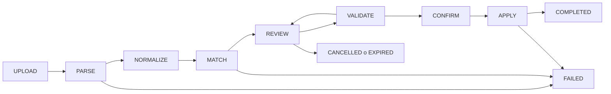

# Diseño — SPEC-03

**Estado:** diseño W0 actualizado con D-01–D-08 aprobadas el 2026-11-03; parámetros y política señalados en [decisions.md](decisions.md) siguen pendientes. D1–D7 referencian [requirements.md](requirements.md). La infraestructura W1-A de catálogo y rutas DRAFT está implementada en rama aislada y documentada en [w1-a-evidence.md](w1-a-evidence.md); los componentes KMZ y comerciales posteriores siguen como diseño.

## 1. Diagnóstico actual

| Capacidad | Estado | Evidencia e implicación |
| --- | --- | --- |
| PostgreSQL/PostGIS y migraciones versionadas | IMPLEMENTED | [0001_postgis.sql](../../apps/api/src/db/migrations/0001_postgis.sql), [migration-manager.ts](../../apps/api/src/db/migration-manager.ts); última migración inspeccionada 0015. Reutilizar la DB GEOPS. |
| Sesión admin, CSRF, audit_event | IMPLEMENTED | [0002_admin.sql](../../apps/api/src/db/migrations/0002_admin.sql), [admin-auth/routes.ts](../../apps/api/src/admin-auth/routes.ts). Ampliar permisos y eventos de catálogo. |
| Idempotencia y ETag en mutaciones GPS | PARTIAL | [gps-policy-routes.ts](../../apps/api/src/gps-policy-routes.ts) aporta patrón, no cubre importaciones. |
| Ingesta/lectura de posiciones y mapa GPS | IMPLEMENTED para GPS | [0009_gps_policies.sql](../../apps/api/src/db/migrations/0009_gps_policies.sql), [gps-event-routes.ts](../../apps/api/src/gps-event-routes.ts), [GpsMap.tsx](../../apps/web/src/gps/GpsMap.tsx). El trazo del mapa es recorrido GPS, no ruta comercial. |
| gps_device_group y admin_permission | IMPLEMENTED para GPS | [0009_gps_policies.sql](../../apps/api/src/db/migrations/0009_gps_policies.sql) y [0015_single_tenant_admin.sql](../../apps/api/src/db/migrations/0015_single_tenant_admin.sql); el grupo es de dispositivos y el CHECK de permisos solo acepta capacidades GPS. No otorga permisos de catálogo. |
| establishment, customer, pin y geozona | DOCUMENTED_ONLY | [SPEC-00 data-model](../spec-00-technical-feasibility/data-model.md); sin migraciones, servicio o API. |
| Rutas comerciales versionadas y visitas recurrentes | DOCUMENTED_ONLY | [PRD](../prd/GEOPS-PRD-v1.1.md), [BR-07/09](../spec-00-technical-feasibility/business-rules.md), [ADR-010](../architecture/adr/ADR-010-visitas-recurrentes.md); no existen tablas/worker operativos de visitas. |
| Importador CSV/XLSX o KMZ, staging y UI de revisión | MISSING | [app.ts](../../apps/api/src/app.ts) y [app.tsx](../../apps/web/src/app.tsx) registran identidad, MDM y GPS, sin importación ni catálogo. |
| Identidad comercial autoritativa | BLOCKED | [SPEC-00 Q-11](../spec-00-technical-feasibility/open-questions.md) pide esquema y muestra autorizada. Se pueden preparar candidatos geográficos sin afirmar cédula. |

Dependencias: ADR-003 mantiene ingesta GPS independiente; ADR-009 propone PostGIS; ADR-010 separa evaluación de visitas en worker; ADR-011 difiere optimización. Ninguna se altera. La autorización administrativa existente se reutiliza, con permisos nuevos y denegación por defecto. La inspección W0 volvió a comprobar que [app.ts](../../apps/api/src/app.ts) solo registra identidad, MDM y GPS; [app.tsx](../../apps/web/src/app.tsx) tampoco tiene catálogo. [GpsMap.tsx](../../apps/web/src/gps/GpsMap.tsx) y Leaflet aportan patrón de visualización, no el mapa de revisión. Los cambios preexistentes del árbol de trabajo no se tocaron.

## 2. D1–D2: flujo, seguridad y staging

Persistir estados RECEIVED, PARSING, MATCHING, REVIEW, VALIDATING, READY_TO_CONFIRM, APPLYING, COMPLETED, FAILED_RETRYABLE, FAILED_FINAL, CANCELLED, EXPIRED. El término UPLOAD/PARSE/… es fase visible; APPLYING se recupera consultando el ledger transaccional. CANCELLED y EXPIRED son terminales sin efecto operativo. Solo staging cambia antes de APPLY.

La API recibe bytes en streaming, calcula SHA-256, guarda en volumen privado con TTL y crea import_session. Validar extensión y magic ZIP, directorio central, CRC, entradas, nombres normalizados, tamaño comprimido y descomprimido, ratio de expansión, número de archivos, profundidad y bytes de XML. No extraer con rutas construidas desde nombres ZIP; rechazar traversal, rutas absolutas, ZIP/KMZ anidados, enlaces y entradas cifradas no soportadas. Parsear KML con DTD/entidades y acceso a red deshabilitados; rechazar NetworkLink y referencias externas. Limitar nodos, profundidad, texto, coordenadas y vértices. [D-05](decisions.md#d-05--cuotas-de-carga) registra valores iniciales propuestos y su evidencia de solo lectura; CPU, memoria y límites definitivos siguen PENDING_VALIDATION.

Guardar jerarquía Folder/Document/Placemark con source_path estable por tipo e índice de hermanos, nombre y padre. Cada registro conserva valores originales, orden, geometría y atributos permitidos, y una representación normalizada separada. Descripción KML se trata como dato no confiable: sanitizar texto/HTML y nunca ejecutar scripts ni cargar recursos remotos. Punto KML = longitud, latitud, altitud en WGS84; validar números finitos, rangos globales y topología. Fuera de Costa Rica es advertencia que exige revisión, no descarte silencioso. Geometría inválida aparece en tabla aunque no en mapa. Polígonos quedan en capa separada y no se convierten en clientes.

Un hash de archivo ya COMPLETED muestra la importación previa y requiere nueva decisión explícita; nunca reaplica automáticamente. Reintento de carga con misma clave/cuerpo puede devolver la sesión anterior. Según D-06, el TTL temporal propuesto es 30 días desde carga: al expirar se impide confirmar, se registra EXPIRED y se limpia por job verificable tras aprobar política; CANCELLED sigue el mismo tratamiento. No se ejecuta limpieza en W0 ni se aplica ese plazo al ledger/auditoría.

## 3. D3: normalización y comparación

Preservar ceros iniciales de códigos. Para comparar: Unicode NFC, trim, compactar espacios, casefold y forma sin acentos; mantener valor original sin pérdida. Distancia en metros con geography(Point,4326). Un código KMZ pertenece al namespace KMZ; no equivale a cédula comercial. Un identificador persistente explícito y autorizado pesa más que código, nombre o distancia.

Orden determinista de señales: (1) ID persistente autorizado; (2) identificador de fuente con namespace y autoridad aprobados; (3) nombre y proximidad; (4) proximidad, grupo y ruta como indicios. Reglas y umbrales son versionados. D-02 aprueba ≤ 50 m como banda inicial de proximidad alta y > 50 a ≤ 250 m como banda ampliada; > 250 m no genera candidato por distancia sola. Son parámetros configurables para comparación y pruebas, nunca aceptación de identidad. Calibración final con casos validados por negocio sigue pendiente. Dos negocios en la misma coordenada permanecen distintos si la identidad no está acreditada; igualdad de código KMZ con negocios diferentes produce conflicto, no fusión.

Clasificación principal excluyente:

| Estado | Regla |
| --- | --- |
| INVALID | Falta dato requerido para acción seleccionada o geometría estructuralmente imposible. |
| CONFLICT | Identidad aprobada apunta a valores incompatibles, o decisiones de filas se contradicen. |
| POSSIBLE_DUPLICATE | Varias filas/candidatos plausibles sin identidad autoritativa inequívoca. |
| EXISTING_MATCH | Una identidad autorizada coincide sin discrepancia material; todavía requiere acción elegida. |
| NEW | No hay candidato según configuración vigente. |

Advertencias ortogonales: OUT_OF_AREA, SAMPLE_LIKE, DUPLICATE_IN_FILE, DUPLICATE_HASH, UNLINKED_STOP, GEOMETRY_WARNING. Cada candidato expone regla, versión, distancia, campos coincidentes/diferentes y versión de entidad. El ranking no preselecciona actualización. El archivo de referencia debe activar revisión de cinco códigos repetidos, copias de Heredia, diez sitios mundiales duplicados y paradas sin cliente. No se afirma que todas esas filas sean errores de negocio.

## 4. D4: experiencia de revisión

Crear sección administrativa Importaciones: lista de sesiones, progreso, autor, hash corto, estado, caducidad y resumen. Tabla paginada/virtualizada: estado; código/nombre original y propuesto; entidad existente; grupo; semana; coordenadas; señales; acción; revisor. Filtrar por estado, grupo, semana, advertencia y acción; buscar código/nombre; fijar bloqueos arriba. Comparación lateral muestra GEOPS, KMZ y propuesta con diferencias, geometría, motivo y versión de coincidencia.

Acciones: CREATE_ESTABLISHMENT, LINK_AUTHORIZED_CUSTOMER, UPDATE_SELECTED_FIELDS, EXCLUDE, LINK_GROUP, CREATE_GROUP y DRAFT_ROUTE. CREATE_ESTABLISHMENT produce candidato geográfico, no customer comercial. LINK_AUTHORIZED_CUSTOMER exige cliente del catálogo CSV/XLSX autorizado o asociación manual explícita. Corregir nombre, código, punto y asociación; motivo obligatorio para actualización/exclusión de conflicto. UPDATE_SELECTED_FIELDS muestra antes/después y conserva campos ausentes del KMZ. Edición usa If-Match de fila/sesión; si otro administrador cambió decisión, mostrar diff y pedir resolución. Una acción masiva exige previsualización de filas y solo se permite si todas comparten regla segura; nunca fusiona automáticamente.

Mapa Leaflet separado del mapa GPS: capas existentes, propuestas, duplicados, grupos, polígonos y paradas, con leyenda y selección bidireccional tabla ↔ mapa. Outliers no fuerzan autozoom mundial; geometría inválida sigue en tabla. Si fallan teselas, tabla y coordenadas continúan operables. Cubrir teclado, foco, contraste, lectura por pantalla y estados carga/vacío/error.

## 5. D5: entidades y frontera con rutas/visitas

Modelo propuesto; se finaliza en W0/W1:

| Entidad | Campos y relación esenciales |
| --- | --- |
| establishment | ID, nombre, clasificación, fuente/namespace/source_key, geog Point, versión, vigencia. Candidato geográfico. |
| customer | ID interno, identificador comercial autoritativo con namespace y origen CSV/XLSX aprobado, vínculo explícito a establishment, versión. Nunca derivar cédula del KMZ. |
| pin | Punto accionable enlazado a establishment/customer; radio, precisión y permanencia versionados cuando se aprueben reglas de visitas. |
| territory_group, territory_member | Agrupación y miembros geográficos; sin implicación de dispositivo o visitas. |
| geo_layer, geo_feature | Entidades futuras fuera del alcance inicial. Los polígonos y LineString de este KMZ quedan solo en import_node/import_record de staging. |
| route, route_version, route_stop | Borrador y versiones operativas; stop enlaza pin confirmado, orden opcional, vigencia/asignación futuras explícitas. |
| import_session, import_node, import_record | Staging: original, jerarquía, normalizado, versión, diagnóstico, archivo/hash. |
| import_candidate, import_decision | Candidatos de match, explicación, actor, corrección, acción y versión. |
| import_operation, import_commit, catalog_revision | Ledger de efectos, resultado idempotente y barrera de cambios concurrentes. |

FK, CHECK, GiST geográficos y unicidad de (import_id, source_path) se diseñan en migraciones W1/W5. Unicidad global solo para ID interno y referencia comercial de autoridad confirmada; nunca UNIQUE global sobre código KMZ. Indexar sesiones por estado/TTL y candidatos por importación. Vincular ledger y audit_event por correlation_id.

Cardinalidades e invariantes propuestas: una import_session tiene muchos import_node/import_record; cada record conserva exactamente un original inmutable y cero o más candidatos, con una decisión vigente y su historial de revisiones. Un customer puede vincular más de un establishment solo mediante decisión explícita; un pin pertenece a un establecimiento, y una route_stop referencia un pin existente y una route_version. territory_member usa par (group_id, establishment_id) único por vigencia. source_key se guarda con namespace y hash del archivo; no se utiliza como identidad comercial. import_commit es único por import_session completada y almacena plan_digest/respuesta; import_operation es única por (import_id, record_id, action) y apunta al destino. Versiones bigint y ETag evitan sobrescritura silenciosa; FK de staging a catálogo son referencias de candidato, no activan efectos. CHECK valida rango y tipo de geometría; las geometrías inválidas permanecen serializadas en staging diagnóstico, nunca en columna geográfica operativa.

Las diez carpetas de clientes son, por defecto, propuestas de territory_group; no rutas operativas. Una ruta necesita acción DRAFT_ROUTE explícita y paradas ligadas a pin y cliente confirmados; calendario, recurrencia, vigencia y asignación deben aprobarse antes de activarla. Una parada sin vínculo queda en staging o excluida; no genera visita. Los 763 Placemark poligonales y la única LineString del archivo quedan solo en staging y no son evidencia de recorrido. Las 100 sedes requieren clasificación comercial antes de llamarlas clientes.

Importar no escribe position_event, gps_policy, gps_scheduled_session ni evaluaciones de visita. Posiciones fuera de ruta se conservan. Rutas y pines se versionan con efecto futuro; importar no reevalúa historia. El motor de visitas seguirá su propia SPEC y ADR-010 cuando existan reglas aprobadas.

## 6. D6: plan, confirmación e integridad

VALIDATE genera plan inmutable unido a session_version, catalog_revision, matcher_version y digest de decisiones. Resume creación de candidatos geográficos, vínculos a cliente autorizado, actualización selectiva, grupos, borradores y exclusiones, además de bloqueos/advertencias. No incluye publicación de polígonos/línea. Bloquean: INVALID seleccionado para aplicar, CONFLICT sin resolver, identidad comercial sin fuente/autorización, vínculo ambiguo, UPDATE sin campos/motivo/versión, parada operativa sin cliente/pin, catálogo cambiado, sesión vencida, falta de permiso y plan/digest obsoleto. Un excluido puede conservar advertencia sin bloquear. Confirmación requiere digest/ETag e Idempotency-Key.

Recomendación: publicación síncrona en una transacción PostgreSQL para el tamaño máximo configurado. En aislamiento SERIALIZABLE, bloquear import_session y catalog_revision FOR UPDATE; verificar estado, digest, permisos y revisión; insertar/actualizar catálogo, grupos y borradores; escribir ledger y audit_event; incrementar catalog_revision; guardar respuesta de import_commit y COMPLETED; COMMIT. Todos los escritores futuros del catálogo deben participar en catalog_revision. Si cambió, devolver 409 REBASE_REQUIRED y repetir MATCH/REVIEW. Una excepción aborta todo. Clave única por (import_id, record_id, action) y clave de confirmación ligada al digest evitan efectos repetidos. Tras timeout, consultar commit antes de reintentar: misma clave y digest devuelve resultado original; misma clave con otro digest devuelve 409.

Un worker asíncrono de aplicación solo sería aceptable si publica todo en una transacción o mantiene generación invisible hasta promoción atómica. No publicar lotes visibles parcialmente. Una corrección posterior a COMPLETED es nueva operación versionada y auditada, nunca borrado silencioso del historial.

## 7. D7: permisos, auditoría y retención

Registrar import_id, hash/nombre, horas, actor de carga/revisión/confirmación, originales, correcciones, asociaciones, exclusiones, motivo, destino y versiones previa/nueva, resultado por fila, errores y reintentos. Ledger y efecto en misma transacción; audit_event contiene resumen redactado y correlation_id. No volcar archivo, nombres, coordenadas masivas o descripciones en logs generales.

Permisos aprobados catalog.import.read, catalog.import.write y catalog.import.confirm, reutilizando sesión admin, control de origen y CSRF. Confirmar exige confirm y lectura del plan; ningún permiso se concede por ser administrador o por tener permisos GPS. [0019_catalog_base.sql](../../apps/api/src/db/migrations/0019_catalog_base.sql) amplió el CHECK de admin_permission y las allowlists de administración sin auto-grants; confirmar importaciones sigue pendiente. KMZ en almacenamiento privado/cifrado con TTL y limpieza verificable corresponde a W2. D-06 propone 30 días para archivo y sesiones; retención de decisiones, ledger y auditoría depende de política autorizada. La retención GPS de 90 días no se extrapola al catálogo.

## 8. Preparación técnica de W1 y resultado W1-A

W1 crea dependencias persistentes antes del parser. Se separa núcleo geográfico de identidad comercial: si la muestra CSV/XLSX autorizada sigue ausente, puede cerrarse diseño del primero, pero no se puede declarar lista la reconciliación de clientes. El catálogo no recibe datos del KMZ durante W1.

| Entidad W1 | Propuesta conceptual W0; implementación W1-A en migración 0019 |
| --- | --- |
| catalog_source | id UUID, authority, namespace, source_type (AUTHORIZED_CSV, AUTHORIZED_XLSX, KMZ_GEO), version, hash, imported_at. Namespace + versión evita confundir código KMZ con identidad. El contrato de ingestión comercial requiere muestra aprobada. |
| customer | id UUID, catalog_source_id FK de fuente autorizada, external_customer_id TEXT, nombre comercial, versión bigint, vigencia; UNIQUE (catalog_source_id, external_customer_id) solo donde la fuente es autoritativa. No aceptar KMZ_GEO como fuente de identidad. |
| establishment | id UUID, nombre, geog geography(Point,4326), classification PENDING/CONFIRMED/DUPLICATE/EXCLUDED, source_id/source_path, versión, vigencia. Puede existir sin customer. |
| customer_establishment | FK a ambos, vigencia, approved_by/at y motivo; vínculo explícito con exclusión de solapamiento incompatible. No se crea por distancia. |
| pin | id UUID, establishment_id FK, geog Point, versión y estado; vínculo a customer confirmado antes de ruta operativa. Radio, precisión y permanencia son nulos/inactivos hasta aprobación de reglas de visitas. |
| territory_group / territory_member | IDs UUID; group con origen y versión; member FK a group/establishment y vigencia. No FK a gps_device_group. |
| route / route_version / route_stop | route con nombre y estado DRAFT; version con número, vigencia opcional y aprobación; stop con FK a version y pin, posición opcional. No permitir ACTIVE sin calendario, recurrencia, vigencia y asignación aprobados; W1 solo DRAFT. |
| catalog_revision | Fila singleton con versión bigint, incrementada por toda escritura de catálogo presente/futura para el rebase de W5. |

**Migraciones propuestas, sin reservar número ni crear SQL en W0:** (1) catalog_source/customer/establishment/customer_establishment/pin con FK, CHECK, UNIQUE e índice GiST; (2) territory_group/member y route/version/stop en DRAFT; (3) extender CHECK de admin_permission y allowlists de [user-administration.ts](../../apps/api/src/admin-auth/user-administration.ts) para las tres capacidades, sin grants por defecto; (4) catalog_revision y contrato de participación obligatoria de todos los escritores. Separar migraciones de staging W2 y ledger W5. Reconfirmar siguiente número libre al iniciar W1; ensayar upgrade y restore con datos sintéticos. DDL definitivo del customer depende del diccionario autorizado D-01.

**Resultado W1-A:** los componentes base anteriores quedaron en 0019. El esquema final difiere de propuestas W0 aún no autorizadas: no contiene hash/imported_at de fuente, EXCLUDED en establecimiento, aprobación de ruta ni identidad comercial definitiva. El estado comercial VERIFIED exige fuente CSV/XLSX autorizada a nivel DB; la API solo crea CANDIDATE y PENDING. Calendario y recurrencia son JSON de borrador opcional en route_version, sin endpoint para activarlos. [Evidencia](w1-a-evidence.md).

**Corrección W1-A-R:** [0020_catalog_integrity.sql](../../apps/api/src/db/migrations/0020_catalog_integrity.sql) agrega validación y locks de destinos activos para nuevas asociaciones, preservando filas históricas; agrega deduplicación de evento de denegación por request_id. El servicio libera la transacción antes de auditar rechazos y devuelve 503 si esa auditoría falla; los eventos de vínculo permiten reconstruir altas, bajas y revinculaciones. La membresía vencida ya no bloquea archive de grupo. [Reauditoría](w1-a-audit.md#reauditoría-w1-a-r--2026-11-03).

**Servicios y contratos W1 propuestos:** consultas paginadas y autorizadas de customer/establishment/pin/territory_group/route DRAFT para alimentar comparación; servicio de escritura interno con validación de versiones y catalog_revision. [api-contracts.md](api-contracts.md#dependencias-de-catálogo-w1) describe lecturas y esquema de error. No abrir endpoint de alta comercial desde KMZ. La carga del CSV/XLSX autoritativo requiere contrato específico, fuente/permiso/aprobación y muestra D-01 antes de implementarse; no se improvisa un importador paralelo en W1.

**Compatibilidad:** no tocar tablas position_event, gps_policy, gps_scheduled_session ni mecanismos Android/MDM. Reutilizar pool, migrador, sesión admin, CSRF, audit_event, idempotencia/ETag como patrón y Leaflet para futura UI; no duplicar gps_device_group o GpsMap. Nuevas lecturas de catálogo deben paginar y redactar campos según capacidad. Índices espaciales y migraciones no deben bloquear ingesta GPS; medir locks/restore en DB aislada.

**Criterios de aceptación W1:** W1-A verificó FK, unicidad, rutas DRAFT, paradas CANDIDATE, revisión del catálogo, permisos sin concesión automática, migración limpia/upgrade/rollback y regresión GPS/Web en bases sintéticas; consultar [w1-a-evidence.md](w1-a-evidence.md). El criterio comercial completo permanece abierto para W1-B: contrato CSV/XLSX autorizado, identidad VERIFIED y muestra/diccionario D-01. Pruebas P06/P08/P11/P15/P17/P18/P19 de waves posteriores no se atribuyen a W1-A. Riesgos pendientes: esquema comercial desconocido, fuente autorizada, calibración geográfica, retención y confirmación transaccional.
